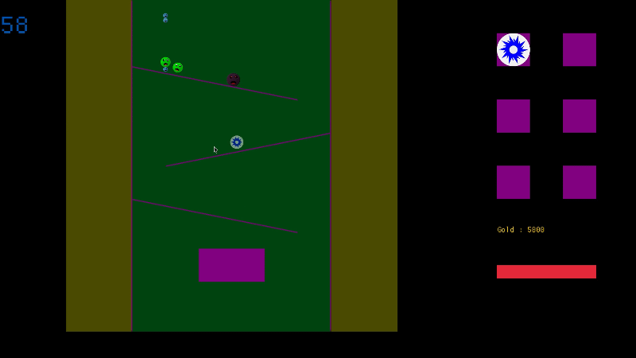

# Simple Physics Engine 2D

A small 2D rigid-body physics engine written 100% in Rust, plus a playable demo (a physics-based tower defense) that shows it working.

The repository is a Cargo workspace with two crates:

| Folder/Crate | What it is |
| :--- | :--- |
| `physics_engine/simple_physics_engine_2d` | The engine itself. No runtime dependencies. |
| `demo/monster_janitor` | Freefall Tower Defense, a game built on top of the engine with macroquad. |



## Engine features

- **Shapes:** circle, rectangle, capsule and line segment.
- **Body types:** Static (never moves), Kinematic (moves only when you tell it to) and Dynamic (affected by gravity, impulses and collisions). Dynamic bodies have a per-body `gravity_scale`.
- **Collision detection:** AABB broad phase followed by a narrow phase with a dedicated test for every shape pair (circle/circle, circle/rect, rect/rect, circle/capsule, rect/capsule, capsule/capsule and the line variants).
- **Collision response:** impulse-based, with restitution (bounciness), friction and angular effects (bodies spin when hit off-center). Overlaps are corrected over several iterations per update.
- **Collision layers:** each body lives in one layer (`layer_bits`) and chooses which layers it interacts with (`mask_bits`), using 16 layers (`Layer::L0` to `Layer::L15`).
- **Hitboxes (sensors):** a body marked with `.with_hitbox()` reports collisions but never pushes or gets pushed. Two hitboxes never collide with each other.
- **Collision events:** every contact is reported as a `CollisionEvent` with both body indices and the impact speed, so your game can react (damage, sounds, particles...).
- **Math and helpers:** a `Vec2` type with the usual operators, a `v2!(x, y)` macro, helpers to sample the outline of a shape as N points, and containment checks (circle contains rect, rect contains point, etc.).
- **Builder-style API:** `Body::new_circle(...).with_restitution(0.8).with_friction(0.3)`.

## Current limitations

- Rectangles are axis-aligned and do not rotate.
- The collision pass checks every pair of bodies, so it is meant for small and medium scenes (no spatial partitioning yet).
- Y axis points down (like most 2D game libraries), so gravity is a positive Y value.

## Quick start

Add the engine to your project (from a local path, since it is not published on crates.io):

```toml
[dependencies]
simple_physics_engine_2d = { path = "../simple-physics-engine-2d/physics_engine" }
```

A ball falling onto a floor:

```rust
use simple_physics_engine_2d::collision_resolver::CollisionEvent;
use simple_physics_engine_2d::prelude::*;

fn main() {
    let mut bodies = vec![
        // pos, velocity, radius, mass
        Body::new_circle(v2!(100.0, 0.0), Vec2::ZERO, 10.0, 1.0).with_restitution(0.6),
        // pos, width, height
        Body::new_static_rect(v2!(100.0, 300.0), 400.0, 20.0).with_restitution(0.6),
    ];

    let mut events: Vec<CollisionEvent> = Vec::new();
    let dt = 1.0 / 60.0;

    for _ in 0..600 {
        events.clear();
        // gravity, linear friction, angular friction
        update_movement(&mut bodies, dt, v2!(0.0, 500.0), 0.0, 0.0);
        update_collisions(&mut bodies, &mut events);

        for e in &events {
            println!("bodies {} and {} collided (impact: {})", e.body_a_id, e.body_b_id, e.impact_force);
        }
    }
}
```

Each frame you call two functions:
1. `update_movement(&mut bodies, dt, gravity, linear_friction, angular_friction)` integrates velocities and positions.
2. `update_collisions(&mut bodies, &mut events)` detects and resolves collisions and fills the event list.

Restitution between two bodies is the lower of the two values (unless one is above 1.0, in which case the higher one is used), so give both bodies a restitution if you want them to bounce.

## Layers example

```rust
use simple_physics_engine_2d::body_shapes::body::Layer;

const PLAYER: u16 = Layer::L0;
const ENEMY: u16 = Layer::L1;

// This player only collides with enemies
let player = Body::new_rot_circle(v2!(0.0, 0.0), Vec2::ZERO, 12.0, 5.0)
    .with_layer_bit(PLAYER)
    .with_mask_bits(ENEMY);
```

Two bodies collide only if each one's mask includes the other's layer.

## Running the examples

You need a recent Rust toolchain with support for edition 2024 (Rust 1.85 or newer).

Engine playground (a bare sandbox with circles, rectangles, capsules and lines; move the circle with the arrow keys):

```bash
cargo run --release --example playground -p simple_physics_engine_2d
```

The demo game (run it from inside `demo/`, because it loads its sprites from the relative `assets/` folder):

```bash
cd demo
cargo run --release
```

## The demo: Freefall Tower Defense

Waves of slimes fall through the level and you stop them with towers, obstacles and your own character, all driven by the physics engine: knockback, bouncing, explosions and wind all come from the same collision system.

- **Enemies:** Slime, Golem and Mini slimes, each with different size, weight, health and bounciness.
- **Towers:** Wizard (energy balls), Archer (arrows) and Bomber (explosive shots). Towers can be upgraded, re-aimed or deleted.
- **Obstacles:** Bumpers (pinball-style), Gravity Zones and Trampolines.
- **Spells:** arrows, energy balls, explosion balls, explosions and a Wind Gale that pushes enemies around.
- **Economy:** you earn gold from enemies and spend it in the shop.

## Controls

| Input | Action |
| :--- | :--- |
| **A / D** | Move left / right |
| **W** | Jump (or wall-jump when touching a wall) |
| **S** | Drop down faster |
| **Left Shift** | Dash in the direction you are moving (casts a Wind Gale) |
| **R** | Aim a Wind Gale spell with the cursor |
| **Left click** | Select, place towers and obstacles, press shop buttons |
| **Right click** | Cancel the current action |

Obstacles are placed with two clicks: the first sets the position and the second sets the angle.

## Project structure

```text
.
├── Cargo.toml                  # workspace
├── physics_engine/
│   ├── examples/playground.rs  # standalone sandbox
│   └── src/
│       ├── lib.rs              # public API and prelude
│       ├── math.rs             # Vec2 and the v2! macro
│       ├── body_shapes/        # Body, Shape and constructors per shape
│       ├── movement_systems.rs # update_movement
│       ├── collision_resolver.rs # broad/narrow phase, impulses, events
│       ├── contain_funcs.rs    # "does A contain B" helpers
│       └── helpers.rs          # shape outline points
└── demo/
    ├── assets/                 # sprites
    └── src/
        ├── world/              # hero, enemies, towers, obstacles, spells, waves
        ├── game_systems/       # one system per concern (collisions, towers, enemies...)
        ├── render/             # drawing and particles
        └── ui/                 # buttons, shop and descriptors
```

## Tests

The engine includes unit tests for the math, the movement update, the point helpers and each collision pair:

```bash
cargo test -p simple_physics_engine_2d
```

## License
## License

This project is licensed under the MIT License. See the [LICENSE](LICENSE) file for details.
